<!-- i18n-source: README.md@82702970a473d6fc63b191fcd2912d2ff9e89e87 status=reviewed -->
<!-- brand:start -->

<p align="center"><picture><source media="(prefers-color-scheme: dark)" srcset="https://raw.githubusercontent.com/muhittincamdali/podexit/main/.github/brand/banner-dark.svg"><source media="(prefers-color-scheme: light)" srcset="https://raw.githubusercontent.com/muhittincamdali/podexit/main/.github/brand/banner-light.svg"></picture></p>

<!-- lang-selector:start -->
<p align="center"><a href="README.md">English</a> · <a href="README.tr.md">Türkçe</a> · <a href="README.zh-CN.md">简体中文</a> · <a href="README.ja.md">日本語</a> · <a href="README.ko.md">한국어</a> · <a href="README.es.md">Español</a> · <a href="README.de.md">Deutsch</a> · <a href="README.fr.md">Français</a> · <a href="README.pt-BR.md">Português (Brasil)</a> · <a href="README.ru.md">Русский</a></p>
<!-- lang-selector:end -->

<p align="center">
<a href="https://github.com/muhittincamdali/podexit/actions/workflows/ci.yml"></a>
<a href="https://github.com/muhittincamdali/podexit/releases"><picture><source media="(prefers-color-scheme: dark)" srcset="https://raw.githubusercontent.com/muhittincamdali/podexit/main/.github/brand/badge-version-dark.svg"><source media="(prefers-color-scheme: light)" srcset="https://raw.githubusercontent.com/muhittincamdali/podexit/main/.github/brand/badge-version-light.svg"></picture></a>
<a href="https://github.com/muhittincamdali/podexit/blob/main/package.json"><picture><source media="(prefers-color-scheme: dark)" srcset="https://raw.githubusercontent.com/muhittincamdali/podexit/main/.github/brand/badge-language-dark.svg"><source media="(prefers-color-scheme: light)" srcset="https://raw.githubusercontent.com/muhittincamdali/podexit/main/.github/brand/badge-language-light.svg"></picture></a>
<a href="https://github.com/muhittincamdali/podexit/blob/main/LICENSE"><picture><source media="(prefers-color-scheme: dark)" srcset="https://raw.githubusercontent.com/muhittincamdali/podexit/main/.github/brand/badge-license-dark.svg"><source media="(prefers-color-scheme: light)" srcset="https://raw.githubusercontent.com/muhittincamdali/podexit/main/.github/brand/badge-license-light.svg"></picture></a>
</p>

<p align="center">
<a href="#inicio-rápido"><picture><source media="(prefers-color-scheme: dark)" srcset="https://raw.githubusercontent.com/muhittincamdali/podexit/main/.github/brand/button-start-es-dark.svg"><source media="(prefers-color-scheme: light)" srcset="https://raw.githubusercontent.com/muhittincamdali/podexit/main/.github/brand/button-start-es-light.svg"></picture></a>
<a href="https://muhittincamdali.github.io/podexit/"><picture><source media="(prefers-color-scheme: dark)" srcset="https://raw.githubusercontent.com/muhittincamdali/podexit/main/.github/brand/button-docs-es-dark.svg"><source media="(prefers-color-scheme: light)" srcset="https://raw.githubusercontent.com/muhittincamdali/podexit/main/.github/brand/button-docs-es-light.svg"></picture></a>
<a href="https://github.com/muhittincamdali/podexit/tree/main/docs/guides"><picture><source media="(prefers-color-scheme: dark)" srcset="https://raw.githubusercontent.com/muhittincamdali/podexit/main/.github/brand/button-guides-es-dark.svg"><source media="(prefers-color-scheme: light)" srcset="https://raw.githubusercontent.com/muhittincamdali/podexit/main/.github/brand/button-guides-es-light.svg"></picture></a>
<a href="https://github.com/muhittincamdali/podexit/tree/main/examples"><picture><source media="(prefers-color-scheme: dark)" srcset="https://raw.githubusercontent.com/muhittincamdali/podexit/main/.github/brand/button-examples-es-dark.svg"><source media="(prefers-color-scheme: light)" srcset="https://raw.githubusercontent.com/muhittincamdali/podexit/main/.github/brand/button-examples-es-light.svg"></picture></a>
</p>

> Esta es una traducción del README en inglés. Si hay diferencias, la versión en inglés es la vigente.

<!-- brand:end -->

CocoaPods trunk pasará a ser de solo lectura el 2 de diciembre de 2026. Tus compilaciones seguirán funcionando, pero los pods publicados allí no recibirán ninguna actualización más. podexit te muestra cuáles de tus dependencias quedan congeladas, cuáles ya ofrecen un paquete de Swift y la ruta de migración para iOS nativo, Flutter y React Native/Expo. Lee el `Podfile.lock` que ya tienes; no se instala nada en tu proyecto.

<picture><source media="(prefers-color-scheme: dark)" srcset="docs/media/demo-native-dark.svg"><source media="(prefers-color-scheme: light)" srcset="docs/media/demo-native-light.svg"></picture>

<sub>Grabado con la CLI real sobre el <a href="fixtures/native-app/Podfile">fixture native-app</a>, con las respuestas de trunk y GitHub guardadas el 14 de octubre de 2026 (<code>npm run demo</code>).</sub>

## Lo más destacado

- **Dos respuestas por pod**: si deja de recibir actualizaciones (congelado en trunk, limitado antes de tiempo por su editor o no afectado) y si su repositorio original tiene un `Package.swift`.
- **Consciente de las versiones**: comprueba también el `Package.swift` en la etiqueta que tienes bloqueada e indica cuándo el paquete de Swift solo existe en versiones más nuevas.
- **Límite de Firebase incluido**: los 20 pods de Firebase que figuran en su lista se limitan a 12.x, junto con sus subdependencias, a partir de un archivo de datos con fuentes que cita la página de Firebase.
- **Nativo, Flutter, React Native y Expo**: encuentra `Podfile.lock` en la carpeta o en `ios/`, `macos/`, `example/ios/` o `example/macos/`, reconoce el tipo de proyecto y enlaza la guía correspondiente.
- **Terminal, Markdown o JSON**: una tabla para ti, Markdown para una pull request y JSON para scripts.
- **Funciona sin conexión**: las respuestas se guardan en caché 24 horas en `~/.cache/podexit`; `--offline` usa solo la caché.

## Inicio rápido

Necesitas [Node.js](https://nodejs.org/) 22.12 o posterior (`node --version` muestra la versión; en un Mac, `brew install node` lo instala). Nada más.

**1. Abre una terminal en la carpeta de tu app**, la que contiene el `Podfile`, la carpeta `ios/` o (en un plugin de Flutter) la carpeta `example/`:

```sh
cd path/to/YourApp
```

**2. Ejecuta podexit:**

```sh
npx podexit
```

**3. Lee la tabla.** Las filas marcadas como **capped** son las primeras en detenerse (Firebase deja de publicar en CocoaPods en octubre de 2026); las marcadas como **frozen after Dec 2** no reciben versiones nuevas después del 2 de diciembre. Donde la columna Swift package dice **yes**, el pod se puede migrar ya. La última línea enlaza la guía para tu tipo de proyecto.

## Qué cambia el 2 de diciembre (y qué no)

Según el [anuncio de CocoaPods](https://blog.cocoapods.org/CocoaPods-Specs-Repo/) y la [página de migración de Firebase](https://firebase.google.com/docs/ios/cocoapods-deprecation):

1. **Las compilaciones siguen funcionando.** El repositorio Specs y la CDN siguen en línea; `pod install` sigue resolviendo todas las versiones ya publicadas. Una prueba del modo de solo lectura se hará del 1 al 7 de noviembre de 2026.
2. **Los pods de trunk no recibirán versiones nuevas** después del 2 de diciembre de 2026, correcciones de seguridad incluidas, a menos que se distribuyan de otra forma (normalmente, un paquete de Swift).
3. **Firebase 12 es la última versión mayor en CocoaPods**, y Firebase deja de publicar allí en octubre de 2026. Las versiones 12 y anteriores seguirán siendo instalables.

Más información en [Qué cambia el 2 de diciembre](docs/guides/what-changes.md).

## Instalación

No hace falta instalar nada: `npx podexit` descarga y ejecuta la última versión. Para fijar una versión en un proyecto o en CI:

```sh
npm install --save-dev podexit
npx podexit
```

o instálalo de forma global con `npm install --global podexit`. El flujo de publicación prepara una fórmula de Homebrew para `muhittincamdali/tap` (prevista con la primera publicación del tap).

## Uso

```text
podexit [paths...] [options]
```

| Opción                  | Qué hace                                                                       |
| ----------------------- | ------------------------------------------------------------------------------ |
| `paths`                 | Archivos `Podfile.lock` o carpetas de proyecto; por defecto, la carpeta actual |
| `-f, --format <format>` | `tty` (por defecto), `markdown` o `json`                                       |
| `-o, --output <file>`   | Escribe el informe en un archivo en lugar de la terminal                       |
| `-a, --all`             | Incluye también en la tabla los pods de rutas locales, git y specs privados    |
| `--offline`             | Usa solo respuestas en caché; nunca accede a la red                            |
| `--refresh`             | Ignora la caché y vuelve a consultar la red                                    |
| `--cache-dir <dir>`     | Carpeta de caché (por defecto `$XDG_CACHE_HOME/podexit` o `~/.cache/podexit`)  |
| `--no-color`            | Texto plano incluso en una terminal (se respetan `NO_COLOR` y `FORCE_COLOR`)   |
| `--concurrency <n>`     | Consultas de pods en paralelo, de 1 a 64 (por defecto 8)                       |

Códigos de salida: `0` informe escrito; `2` argumentos incorrectos, no se encontró ningún `Podfile.lock` o el archivo no es uno; `1` cualquier otro error inesperado. podexit informa; no hace fallar una compilación por lo que encuentre.

Sin rutas, podexit lee cada lockfile que encuentra en `Podfile.lock`, `ios/Podfile.lock`, `macos/Podfile.lock`, `example/ios/Podfile.lock` y `example/macos/Podfile.lock`; una carpeta pasada como ruta se busca de la misma forma.

| Variable de entorno        | Qué hace                                                                         |
| -------------------------- | -------------------------------------------------------------------------------- |
| `PODEXIT_CACHE_DIR`        | Carpeta de caché cuando no se indica `--cache-dir`                               |
| `GITHUB_TOKEN`, `GH_TOKEN` | Solo se envía a hosts de GitHub; necesaria para repositorios originales privados |
| `NO_COLOR`, `FORCE_COLOR`  | Desactiva o activa los colores en la terminal                                    |

### Guarda un informe en Markdown junto al código

```sh
npx podexit --format markdown --output podexit.md
```

La versión en Markdown tiene las mismas tablas, las fechas de publicación y los enlaces al repositorio de cada paquete de Swift; los pods de rutas locales y de git se agrupan en un bloque `<details>`.

### Usa el informe JSON en scripts

```sh
npx podexit --format json > podexit.json
```

Cada pod incluye `updates.status`, `swiftPackage.status`, la última versión en trunk con su fecha y una frase que explica cada respuesta. El formato es `schemaVersion` 0 y puede cambiar antes de la 1.0. [examples/shell/frozen-pods.sh](examples/shell/frozen-pods.sh) lo filtra con `jq`.

### Ejecútalo en CI

[examples/github-actions/podexit.yml](examples/github-actions/podexit.yml) añade el informe al resumen del job de cada pull request que modifica un `Podfile.lock`.

### Límites de uso y repositorios privados

podexit lee `Package.swift` a través de raw.githubusercontent.com, que no consume la cuota de la API de GitHub. Define `GITHUB_TOKEN` (o `GH_TOKEN`) para consultar repositorios originales privados; el token solo se envía a hosts de GitHub.

### Desde JavaScript

```js
import {
  analyzeLockfile,
  buildReport,
  CachedFetcher,
  HttpFetcher,
  loadPublisherPolicy,
  render,
} from 'podexit';

const policy = loadPublisherPolicy();
const fetcher = new CachedFetcher(new HttpFetcher({ userAgent: 'my-tool' }), {
  directory: '.cache',
});
const lockfile = await analyzeLockfile(text, 'ios/Podfile.lock', { fetcher, policy });
console.log(render(buildReport([lockfile], { policy, offline: false }), 'markdown'));
```

Hay una versión ejecutable en [examples/api/summary.mjs](examples/api/summary.mjs).

## Demo

Las tres grabaciones proceden de los [fixtures](fixtures/README.md): proyectos reales creados con cada toolchain y resueltos con CocoaPods 1.16.2, reproducidos con las respuestas guardadas el 14 de octubre de 2026.

| Proyecto                                             | Grabación                                                                               |
| ---------------------------------------------------- | --------------------------------------------------------------------------------------- |
| App iOS nativa (Firebase, Alamofire, Google Sign-In) | parte superior de esta página                                                           |
| App de Flutter (FlutterFire, google_sign_in, …)      | [claro](docs/media/demo-flutter-light.svg) · [oscuro](docs/media/demo-flutter-dark.svg) |
| App de Expo SDK 57 (Sentry, RevenueCat, Lottie)      | [claro](docs/media/demo-expo-light.svg) · [oscuro](docs/media/demo-expo-dark.svg)       |

Medido en un Mac (Apple silicon, M5 Max) con Node.js 25.9 el 14 de octubre de 2026: una primera ejecución sobre el fixture nativo (28 pods) hizo 112 peticiones y tardó de 6,6 a 7,1 segundos; una segunda ejecución respondió desde la caché en 0,3 segundos. La velocidad de la red decide la mayor parte del primer número.

Para grabarlas de nuevo: `npm run demo`.

## Estado

| Funcionalidad                                                                       | Estado            |
| ----------------------------------------------------------------------------------- | ----------------- |
| Leer `Podfile.lock`: pods, subspecs, grafo de dependencias, origen de cada pod      | funciona          |
| Última versión y fechas de publicación desde CocoaPods trunk                        | funciona          |
| `Package.swift` en la rama por defecto y en la etiqueta bloqueada                   | funciona          |
| Límites de los editores (Firebase 12.x) y sus subdependencias                       | funciona          |
| Detección de nativo, app de Flutter, plugin de Flutter, React Native y Expo         | funciona          |
| Informes en terminal, Markdown y JSON; reproducción de caché con `--offline`        | funciona          |
| Indicar el paquete de npm o pub.dev que trae cada pod                               | planificado (0.3) |
| Nombres de producto y versiones del paquete de Swift por pod, `plan` → MIGRATION.md | planificado (0.5) |
| Salida SARIF, `--fail-on`, GitHub Action                                            | planificado (0.5) |
| Modo autor: podspec → punto de partida de `Package.swift`                           | planificado (0.8) |
| `--fix` para Flutter, página web estática, esquema JSON estable                     | planificado (1.0) |

## Documentación

Referencia de la API y guías: [muhittincamdali.github.io/podexit](https://muhittincamdali.github.io/podexit/).

## Guías

- [Qué cambia el 2 de diciembre (y qué no)](docs/guides/what-changes.md)
- [iOS nativo: de CocoaPods a Swift Package Manager](docs/guides/native-ios.md)
- [Apps y plugins de Flutter](docs/guides/flutter.md)
- [React Native y Expo](docs/guides/react-native-expo.md)
- [Firebase después de la versión 12](docs/guides/firebase.md)
- [Autores de pods: cómo sustituir `pod trunk push`](docs/guides/pod-authors.md)

## Requisitos

| Toolchain | Versión mínima |
| --------- | -------------- |
| Node.js   | 22.12          |

CI ejecuta las pruebas en Node.js 22 y 24 (Linux). En local pasan con Node.js 22.23, 24.22 y 25.9 en un Mac (Apple silicon).

## Arquitectura

```text
Podfile.lock ─► parseLockfile          pods, subspecs, dependency graph, source per pod
             ─► classifyLockfile       frozen-on-trunk | capped | not-affected | unknown
                  data/publisher-policy.json (sourced; Firebase 12.x)
             ─► analyzeLockfile        per trunk pod, through a Fetcher:
                  cdn.cocoapods.org    versions and podspec (GitHub repository and tag)
                  trunk.cocoapods.org  release dates
                  raw.githubusercontent.com  Package.swift at HEAD and at the locked tag
             ─► buildReport ─► render  tty | markdown | json
```

- `src/core/` es puro: análisis, comparación de versiones, clasificación. Sin E/S.
- Todo lo que viene de la red pasa por un `Fetcher`. `CachedFetcher` guarda un archivo JSON por petición; esos mismos archivos son las respuestas grabadas que reproducen las pruebas y `--offline`.
- Una respuesta que falta se informa como `unknown` con su motivo, nunca como un error.
- La CLI (`src/cli/`) solo analiza argumentos, busca lockfiles y escribe la salida.

## Hoja de ruta

Consulta la tabla de [Estado](#estado): 0.3 añade el paquete de npm y pub.dev que hay detrás de cada pod, 0.5 el plan de migración, SARIF y una GitHub Action, 0.8 el modo autor y 1.0 un esquema JSON estable. [CHANGELOG.md](CHANGELOG.md) enumera los cambios de cada versión.

## FAQ

**¿Dejará mi app de compilar el 2 de diciembre?** No. Tanto CocoaPods como Firebase dicen que las versiones existentes seguirán siendo instalables. podexit trata de las actualizaciones que no recibirás, no de compilaciones que se detengan.

**¿Por qué un pod aparece como "unknown"?** Su podspec apunta a un host distinto de GitHub (por ejemplo, un binario en dl.google.com) o la red no estaba disponible. Los informes JSON y Markdown indican el motivo de cada pod.

**¿Por qué los plugins de Flutter y los módulos de React Native aparecen como "not affected"?** Son pods de ruta local procedentes de `.symlinks/plugins` o `node_modules`; se actualizan con pub o npm. Los SDK de los que dependen se listan por separado, y esos sí pueden estar congelados.

**¿podexit modifica mi proyecto?** No. Lee `Podfile.lock` y solo escribe su caché y el informe que le pidas.

## Contribuir

Las contribuciones son bienvenidas. Lee [CONTRIBUTING.md](CONTRIBUTING.md) y el [código de conducta](https://github.com/muhittincamdali/.github/blob/main/CODE_OF_CONDUCT.md) antes de abrir una pull request. Informa de los problemas de seguridad como se describe en [SECURITY.md](SECURITY.md).

## Licencia

Publicado bajo la licencia MIT. Consulta [LICENSE](LICENSE).
