# Flutter apps and plugins

Flutter plugins reach CocoaPods in two ways: each plugin is a local path pod
(`.symlinks/plugins/<plugin>/ios`), and many plugins depend on SDK pods from trunk. Only the second
kind stops getting updates on December 2.

<picture><source media="(prefers-color-scheme: dark)" srcset="../media/demo-flutter-dark.svg"><source media="(prefers-color-scheme: light)" srcset="../media/demo-flutter-light.svg"></picture>

The recording above is the [flutter-app fixture](../../fixtures/flutter-app/pubspec.yaml), resolved
with Flutter 3.41.5 and CocoaPods 1.16.2 on 14 October 2026.

## Apps

```sh
npx podexit            # in the app folder; reads ios/Podfile.lock and macos/Podfile.lock
```

The "Pulled in by" column names the plugin pod that brings each SDK in, for example
`GoogleSignIn` ← `google_sign_in_ios`. Mapping plugin pods back to pub.dev package names is
planned for podexit 0.3.

According to the
[Flutter documentation](https://docs.flutter.dev/packages-and-plugins/swift-package-manager/for-app-developers),
Swift Package Manager support is on by default as of Flutter 3.44, and Flutter falls back to
CocoaPods while any plugin in the project does not support it. So the work is:

1. Upgrade Flutter and the plugins. Plugins that ship `ios/<plugin>/Package.swift` no longer need
   CocoaPods; their SDK pods disappear from `Podfile.lock`.
2. If you turned Swift Package Manager off earlier, turn it back on:
   `flutter config --enable-swift-package-manager` (or remove `enable-swift-package-manager: false`
   from the `flutter: config:` section of `pubspec.yaml`).
3. Run `npx podexit` again. What is left are plugins still on CocoaPods; check their issue
   trackers for Swift Package Manager support.
4. When every plugin supports it, follow the Flutter documentation to remove CocoaPods
   integration (`pod deintegrate`, then delete `ios/Podfile`, `ios/Podfile.lock`, `ios/Pods/` and
   the `#include` lines for Pods in `ios/Flutter/*.xcconfig`).

FlutterFire follows Firebase: the
[Firebase page](https://firebase.google.com/docs/ios/cocoapods-deprecation) says updating to the
latest FlutterFire moves the Apple side to Swift Package Manager automatically.

## Plugins

Run podexit on the example app, which is where a plugin's lockfile lives:

```sh
npx podexit            # in the plugin folder; reads example/ios/Podfile.lock
```

The [flutter-plugin fixture](../../fixtures/flutter-plugin/ios/image_cache_plugin.podspec)
depends on SDWebImage and SDWebImageWebPCoder; the report shows both have a Swift package, while
`libwebp` (pulled in by the WebP coder) has none on its default branch. That is the dependency to
solve before the plugin can drop CocoaPods.

To add Swift Package Manager support, follow
[Swift Package Manager for plugin authors](https://docs.flutter.dev/packages-and-plugins/swift-package-manager/for-plugin-authors).
Keep the podspec while your users still build with CocoaPods.
