# React Native and Expo

In a React Native or Expo app, almost every pod comes from `node_modules` (React Native itself,
Expo modules, community libraries). Those are local path pods: they update with npm, not through
trunk. Trunk pods are the native SDKs that some libraries depend on.

<picture><source media="(prefers-color-scheme: dark)" srcset="../media/demo-expo-dark.svg"><source media="(prefers-color-scheme: light)" srcset="../media/demo-expo-light.svg"></picture>

## What the fixtures show

Both were created and resolved on 14 October 2026 (CocoaPods 1.16.2).

| Fixture                                                                  | Pods | From trunk                                                              |
| ------------------------------------------------------------------------ | ---- | ----------------------------------------------------------------------- |
| [Expo SDK 57](../../fixtures/expo-app/package.json), React Native 0.86.3 | 100  | `lottie-ios`, `PurchasesHybridCommon`, `RevenueCat`, `Sentry`           |
| [React Native 0.87.1](../../fixtures/rn-app/package.json)                | 105  | Google Sign-In and its dependencies, `MMKVCore`, `TOCropViewController` |

The React Native app uses React Native Firebase 26 and Stripe 0.82, yet no Firebase or Stripe pod
appears in its lockfile: those libraries declare the SDKs with `spm_dependency`, the helper React
Native provides from 0.75, so Xcode fetches them as Swift packages. Updating a library can
therefore remove its trunk pods; run podexit again after upgrading.

## Steps

```sh
npx @mcamdali/podexit            # in the app folder; reads ios/Podfile.lock
```

1. For each trunk pod, look at "Pulled in by" to find the React Native library that needs it.
   (Mapping pods to npm package names is planned for podexit 0.3.)
2. Check whether a newer version of that library moved the SDK to `spm_dependency` or dropped it,
   and upgrade.
3. For the rest, open an issue with the library, or plan to stay on the last SDK version from
   trunk until it moves.

## Leaving CocoaPods entirely

React Native and Expo still set up iOS projects with CocoaPods. Work on a Swift Package Manager
setup is underway:

- React Native 0.88 (a release candidate on 14 October 2026) can set up an iOS project with Swift
  Package Manager instead of CocoaPods, according to
  [expo/expo#51023](https://github.com/expo/expo/pull/51023).
- That pull request, merged on 14 October 2026, adds an `experiments.swiftPackageManager` app
  config setting to Expo. Check the Expo changelog for the SDK release that ships it.
- The long-running proposal is
  [react-native-community/discussions-and-proposals#587](https://github.com/react-native-community/discussions-and-proposals/issues/587).

Until then, CocoaPods keeps working: the pods you have stay installable after December 2.
